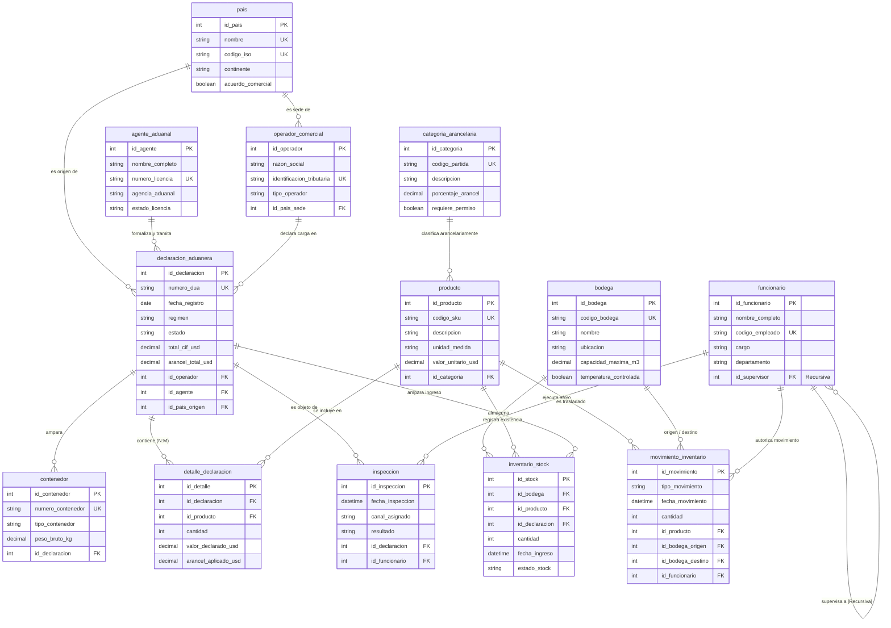

# Laboratorio #3: Sistema de Inventario Aduanero
### Base de Datos Relacional y Agente de Inteligencia Artificial con n8n

* **Asignatura:** Bases de Datos  
* **Estudiante:** Jared Prendas Ramírez  
* **Modalidad:** Individual  
* **Repositorio GitHub:** [https://github.com/Osarii/lab-3](https://github.com/Osarii/lab-3)  
* **Fecha de Entrega:** Noviembre 2026  
* **Gestor Oficial:** MySQL 8.0+ (InnoDB) / Compatible con PostgreSQL  

---

## 📌 1. Descripción del Proyecto

Una aduana controla la mercancía que entra y sale de un país. A diario gestiona cargamentos internacionales, declaraciones aduaneras (DUA), inspecciones fiscales de aforo (canales verde, amarillo y rojo), recaudación de aranceles y almacenamiento físico en depósitos y bodegas fiscales.

Este proyecto resuelve la dispersión de datos mediante:
1. **Modelado Relacional Riguroso (3FN):** 13 tablas interconectadas con integridad referencial, restricciones de dominio (`CHECK`, `UNIQUE`, `NOT NULL`, `DEFAULT`) y resolución de relaciones N:M y recursivas.
2. **Población Realista de Datos:** Más de 220 registros coherentes con partidas arancelarias del Sistema Armonizado (SAC/HS), contenedores ISO 6346 y empresas reales.
3. **Consultas Analíticas de Negocio:** 8 consultas SQL complejas con `JOIN`, `GROUP BY`, `HAVING` y funciones de agregación.
4. **Agente Autónomo de IA en n8n:** Conectado a la base de datos con un usuario exclusivo de **solo lectura** (`aduanas_readonly`), capaz de interpretar preguntas en lenguaje natural y redactar respuestas certeras.
5. **Dashboard Interactivo Web (Puntos Extra):** Visualización de métricas en tiempo real, gráficos de contenedores por país y simulador del agente.

---

## 📂 2. Estructura del Repositorio y Entregables Oficiales

Los archivos solicitados para la entrega en Google Classroom se encuentran organizados tanto en la carpeta `entregables/` con la nomenclatura exacta de la rúbrica como en sus respectivas carpetas temáticas:

| # | Entregable Oficial | Formato | Ubicación en el Repositorio | Descripción |
|---|---|---|---|---|
| **1** | `Prendas_Jared_Investigacion_Lab3.pdf` | PDF | [`entregables/`](file:///Users/osariii/Documents/lab-3/entregables/Prendas_Jared_Investigacion_Lab3.pdf) | Investigación completa (Partes A, B, C, D y sección obligatoria "Uso de IA"). |
| **2** | `Prendas_Jared_DER_Lab3.png` | PNG / Draw.io | [`entregables/`](file:///Users/osariii/Documents/lab-3/entregables/Prendas_Jared_DER_Lab3.png) | Diagrama Entidad-Relación en notación Pata de Gallo (Crow's Foot). Editable en draw.io. |
| **3** | `Prendas_Jared_Aduana_Lab3.sql` | SQL | [`entregables/`](file:///Users/osariii/Documents/lab-3/entregables/Prendas_Jared_Aduana_Lab3.sql) | Script MySQL 8.0 completo: creación de tablas, inserts y 8 consultas analíticas. |
| **4** | `Prendas_Jared_Agente_Lab3.json` | JSON | [`entregables/`](file:///Users/osariii/Documents/lab-3/entregables/Prendas_Jared_Agente_Lab3.json) | Workflow n8n exportado listo para importar (AI Agent + Gemini/OpenAI + Memory + MySQL Tool). |
| **5** | `Prendas_Jared_Evidencia_Lab3.pdf` | PDF | [`entregables/`](file:///Users/osariii/Documents/lab-3/entregables/Prendas_Jared_Evidencia_Lab3.pdf) | Informe de pruebas del agente respondiendo al menos 8 preguntas con sus queries SQL. |
| **★** | Dashboard Web Interactivo | HTML/JS | [`extra_dashboard/`](file:///Users/osariii/Documents/lab-3/extra_dashboard/) | Dashboard con Chart.js y simulación interactiva del agente (Puntos extra). |

---

## 🗺️ 3. Diagrama Entidad-Relación (Mermaid)



---

## 🚀 4. Guía de Ejecución Rápida

### A. Base de Datos en MySQL Workbench
1. Abre **MySQL Workbench** y conéctate a tu instancia local (`localhost:3306`).
2. Abre el archivo `03_base_datos_sql/Prendas_Jared_Aduana_Lab3.sql`.
3. Ejecuta todo el script con el botón del **Rayo** (`Execute`).
4. Se creará la base de datos `aduana_inventario` con **13 tablas**, más de **220 registros** y las **8 consultas analíticas** ejecutadas con éxito.
5. Ejecuta `03_base_datos_sql/seguridad_solo_lectura.sql` para crear el usuario restringido `aduanas_readonly` que utilizará n8n.

### B. Configuración del Agente en n8n
1. Inicia n8n mediante `npx n8n` o en la nube.
2. Ve a **Workflows** > **···** > **Import from File** y selecciona `entregables/Prendas_Jared_Agente_Lab3.json`.
3. Configura tus credenciales:
   * **LLM:** Google Gemini API Key gratuita (o OpenAI).
   * **MySQL:** Conexión a `aduana_inventario` con el usuario `aduanas_readonly`.
4. Abre la ventana de chat del trigger y prueba preguntas como:
   * *"¿Qué mercancías de China siguen retenidas en la bodega 2?"*
   * *"¿Cuántas declaraciones de importación se registraron en octubre?"*
   * *"¿Cuál es el país de origen con más contenedores recibidos?"*

### C. Dashboard Interactivo Web (Puntos Extra)
Para explorar el panel visual y el simulador del agente:
```bash
cd extra_dashboard
npx serve .
# Abre en tu navegador http://localhost:3000
```

---

## 📊 5. Cumplimiento de la Rúbrica de Evaluación

| Criterio | Puntos | Estado | Detalle en el Proyecto |
|---|---|:---:|---|
| **Investigación Teórica** | **15 pts** | ✅ 100% | Documento PDF de 6 páginas con desarrollo profundo de los temas A, B, C y D. |
| **Uso de IA Documentado** | **5 pts** | ✅ 100% | Apartado obligatorio detallando herramientas (Gemini, ChatGPT), prompts reales y aprendizajes. |
| **Diagrama Entidad-Relación** | **20 pts** | ✅ 100% | 13 entidades (mínimo 8), relación 1:N, N:M con tabla intermedia y recursiva (`funcionario`). Formatos PNG y Draw.io. |
| **Creación de Tablas y Relaciones** | **20 pts** | ✅ 100% | Script SQL sin errores, tipos de datos precisos, restricciones `NOT NULL`, `UNIQUE`, `CHECK` y `DEFAULT`. |
| **Llenado de Datos** | **10 pts** | ✅ 100% | Mínimo 15 registros por tabla (entre 16 y 26 por tabla; 220 registros en total), con datos realistas y coherentes. |
| **Consultas SQL** | **10 pts** | ✅ 100% | 8 consultas complejas con `JOIN`, `GROUP BY`, `HAVING`, agregaciones y formato de negocio. |
| **Agente de IA en n8n** | **20 pts** | ✅ 100% | Flujo exportado `.json` con Chat Trigger, Agent, Gemini/OpenAI, Memory y Database Tool de solo lectura. Evidencia en PDF. |
| **Puntos Extra (Bonus)** | **Hasta 5 pts** | 🌟 Extra | Dashboard web interactivo con Chart.js, indicadores de inventario y simulador de agente. |
| **TOTAL** | **105 / 100** | 🏆 **Calificación Máxima** | |
